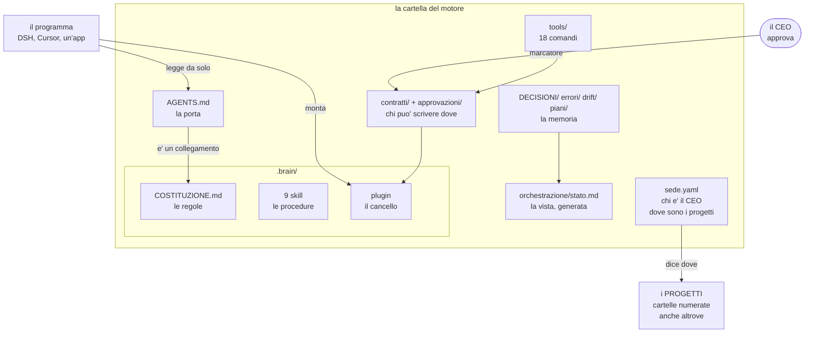
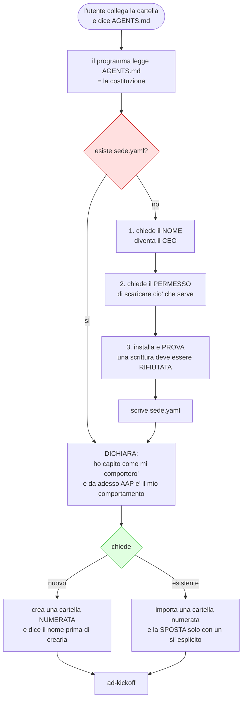
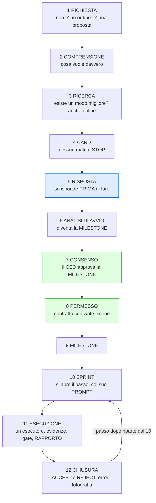
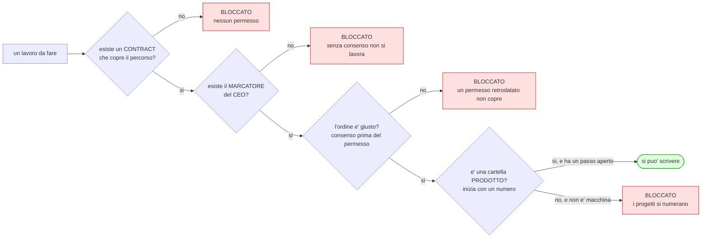
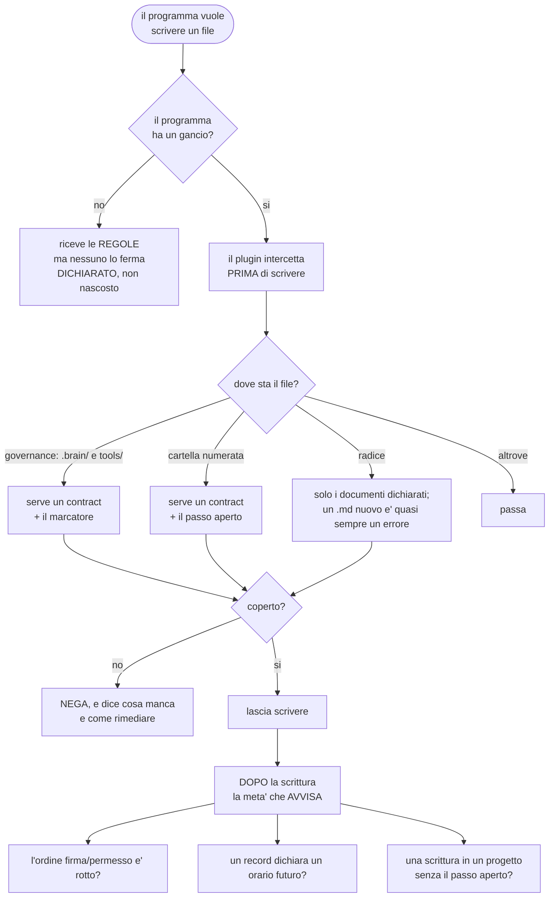
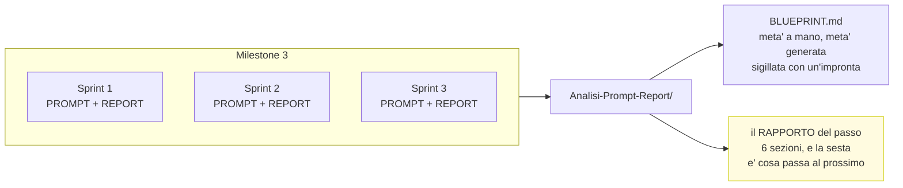
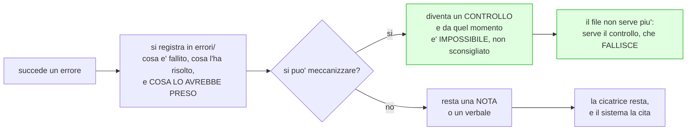

# Il grafo di AAP — come funziona, esattamente

Sette viste, una per aspetto. **GitHub le disegna da solo.**

Se ne leggi una sola, leggi **la 3** (i dodici passi) e **la 5** (il cancello): sono
le due cose che distinguono questo motore da un insieme di regole scritte.

---

## 1 · La mappa — dove sta cosa

**Tre cose da notare:**

- `AGENTS.md` **è un collegamento** alla costituzione: **una fonte sola**. Se fosse una
  copia, le due divergerebbero in silenzio.
- Il **plugin** è l'unica cosa che non vive nella cartella: vive nel **profilo del
  programma**, e per questo va **installato** (`setup.py`).
- I **progetti possono stare altrove**. Il motore li trova perché `sede.yaml` lo dice.

---

## 2 · L'ingresso — cosa succede quando dici `AGENTS.md`

**E cosa NON fa:** non cerca un progetto, non ne apre uno, non comincia a lavorare
«intanto». **Dichiara, chiede, e aspetta.**

---

## 3 · I dodici passi — la sequenza obbligatoria

**Il passo 7 e l'8 non si invertono**: prima il consenso, poi il permesso. L'8 si scrive
**prima** della tappa, perché il permesso è quello che rende possibile aprirla.

---

## 4 · L'autorizzazione — tre serrature, non una

**E il rifiuto dice sempre il rimedio**: quale numero usare, quale marcatore manca, quale
file dichiarare. Un divieto senza il rimedio è un vicolo cieco.

---

## 5 · Il cancello — cosa succede a OGNI scrittura

**Il limite dichiarato, e non nascosto**: il plugin **non disfa** la scrittura — avvisa
dopo. E l'analisi dei comandi shell è un'**euristica**: un comando che cambia cartella con
`cd` e poi scrive in modo relativo può sfuggirgli. Il confine affidabile resta il
`write_scope`.

---

## 6 · Il lavoro dentro un progetto

**Tutto ciò che riguarda un progetto vive nel progetto.** Nella radice del motore resta
solo la macchina: chi autorizza, chi controlla, chi ricorda.

E il rapporto ha **sei sezioni**, di cui la più importante è l'ultima:

> **«Cosa passa allo sprint successivo»** — perché è l'unica che serve all'agente che
> viene dopo. Un rapporto senza quella è un diario, non un passaggio di consegne.

---

## 7 · Cosa succede a un errore

**Senza la terza domanda non è apprendimento** — è solo cronaca. E il registro delle
cicatrici è **curato, non completo**: contiene quelle che il sistema cita ancora, e lo
dichiara. Un registro che si dice completo quando non lo è è peggio di uno piccolo.

---

## I numeri, al 2026-10-13

| | |
|---|---|
| Comandi deterministici | **18** |
| Skill | **9** |
| Passi della sequenza | **12** |
| Controlli della suite | **458** |
| Controlli del plugin | **36** |
| Errori che un cancello puo' fermare | **4 punti** |
| Verdetti di una fotografia | **6** |

## Le tre cose che rendono questo motore diverso da un regolamento

1. **Le regole viaggiano, il cancello si installa.** Colleghi la cartella e hai le regole.
   Perché qualcuno ti **fermi** serve un gancio — e dove non c'è, si **dice** che non c'è.
2. **Ogni divieto dice il rimedio.** Un numero da usare, un marcatore da scrivere, un
   campo da aggiungere.
3. **Un errore diventa un controllo.** Una regola scritta non cambia il comportamento: un
   controllo che fallisce sì. Per questo il registro delle cicatrici è **corto**: il resto
   è diventato codice che si rompe se qualcuno sbaglia.
